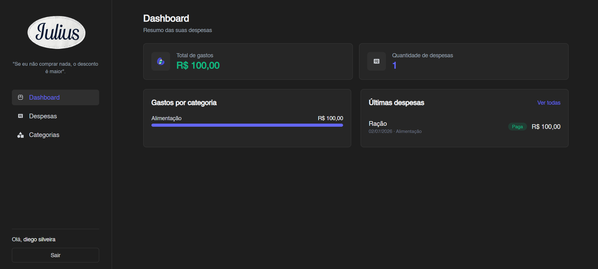
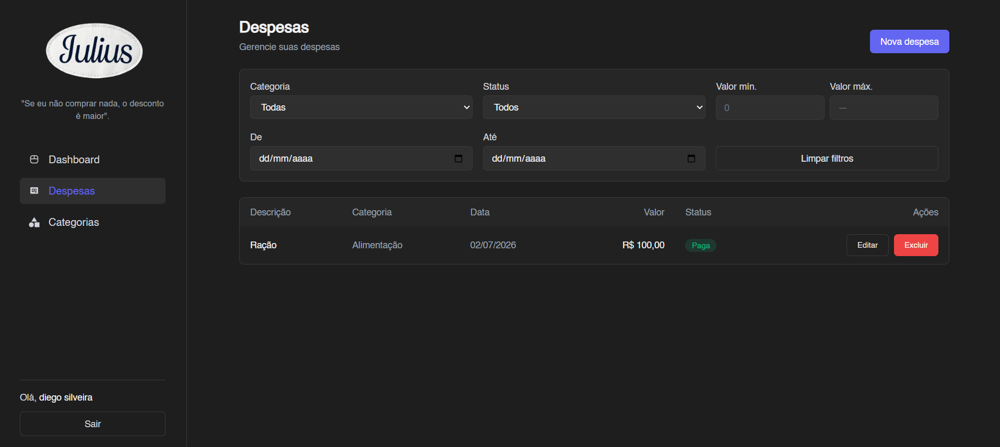
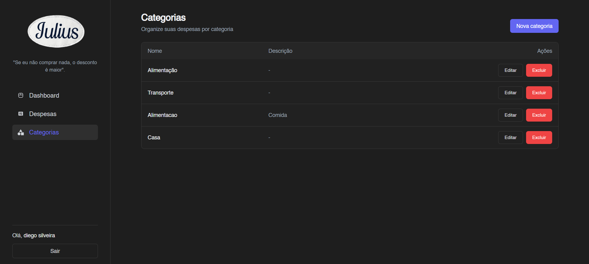
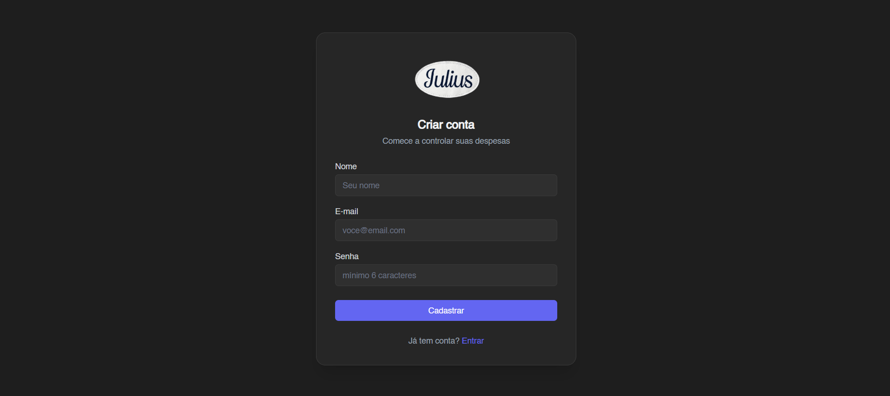

# Julius — Controle de Despesas Pessoais

Aplicação web para organizar despesas pessoais, acompanhar gastos em um dashboard e gerenciar categorias. O projeto reúne o frontend React e uma API REST com autenticação, persistência em PostgreSQL e documentação Swagger.

## Visão geral

- Cadastro, login e autenticação com token JWT.
- Dashboard com total e quantidade de despesas, resumo por categoria e despesas recentes.
- Cadastro, edição, listagem e exclusão de categorias e despesas.
- Filtros de despesas por categoria, status, período e faixa de valores.
- Interface responsiva com feedback de carregamento, validação e notificações.
- Dados e dashboard separados por usuário autenticado.
- Controle parental: o responsável cria contas para os filhos, escolhe o que cada um pode usar e acompanha os gastos deles.

## Telas

### Dashboard



### Despesas



### Categorias



### Acesso



## Tecnologias

**Frontend:** React 19, Vite, React Router, Axios e Tailwind CSS.  
**Backend:** Node.js, Express, Sequelize, PostgreSQL, JWT e bcrypt.  
**Documentação da API:** Swagger.

## Como executar

### Pré-requisitos

- Node.js 18 ou superior
- Docker e Docker Compose

### 1. Inicie o backend

Em um terminal, entre na pasta `backend`:

```bash
cd backend
```

Crie o arquivo `.env` com base em `.env.example` e ajuste as configurações se necessário. Depois, execute:

```bash
docker compose up -d
npm install
npm run db:migrate
npm run db:seed
npm start
```

A API ficará disponível em `http://localhost:3000` e o Swagger em `http://localhost:3000/api/docs`. A carga de dados de exemplo é opcional.

### 2. Inicie o frontend

Em outro terminal, na raiz do repositório:

```bash
cd frontend
```

Crie o arquivo `.env` com base em `.env.example` e execute:

```bash
npm install
npm run dev
```

Acesse `http://localhost:5173`. Em desenvolvimento, o Vite encaminha as chamadas `/api` para o backend local na porta 3000.

## Documentação detalhada

- [README do frontend](frontend/README.md) — funcionalidades, configuração e scripts.
- [README do backend](backend/README.md) — configuração, autenticação, rotas e exemplos da API.
- [Coleção Postman](backend/docs/personalExpenses.postman_collection.json) — requisições para explorar a API.
